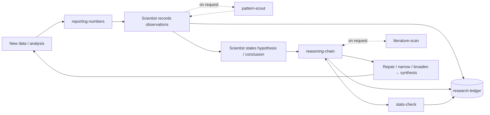

# co-scientist

**Agent skills that make an AI agent a scientific partner, one that augments human scientists through complementary skills.**

*Version: see [`VERSION`](VERSION). Early and evolving: developed in the open and iterated on through real research projects.*

---

## Why this exists

Human scientists and AI agents are good at different things.

**Humans** are good at judging what is *interesting*: which observation is striking, which question matters to the field, which story is worth pursuing, seeing the bigger picture.

**Humans struggle** with things an agent can do well:

- **Statistical intuition.** Is r = 0.4 with n = 12 meaningful? Is this a real effect or regression to the mean? How many comparisons did we actually make?
- **Seeing where the data points.** In large result sets, patterns are easy to miss.
- **Keeping track.** When many analyses produce many numbers, it is hard to remember what has been established, what was assumed, and what the chain of reasoning to a conclusion actually is.
- **Knowing the literature broadly.** Has this or similar questions already been answered? Is there a standard method for this analysis that I am unaware of?

Left to themselves, agents have their own failure modes: jumping to conclusions too fast, getting side-tracked on minor issues, and over confidence.

`co-scientist` is a set of skills that splits the work along these lines. The human decides what matters and commits to conclusions. The agent checks that those conclusions are grounded, keeps the project's memory, and scouts the data and literature when asked. The aim is synergy: a human–agent team that does better science than either would alone.

## Division of labour

| | Human scientist | Agent |
|---|---|---|
| **Decides** | What is interesting; which story to pursue; the final conclusion | Nothing final: it proposes, checks and records |
| **Brings** | Domain intuition; judgement of significance | Statistics; systematic search across data; disciplined record-keeping (via the ledger); broad recall of prior work |
| **Agent's roles** | | **Auditor** (is it grounded?) · **Memory** (ledger, reasoning chain) · **Scout** (only on request) |

Design principles:

- **The agent does not lead the interpretation.** The human looks at the results and records observations first, so the agent's reading does not anchor theirs.
- **Conclusions are built as explicit chains.** Observations → inferences → conclusion, with every assumption written out and every link checked.
- **Critique serves the conclusion.** The agent raises issues that would break the chain to the conclusion being tested. Interesting but non-decisive questions are parked, not used to stall progress. If a conclusion cannot be supported, it is narrowed, or the search broadens. For example checking if arguments or claims have enough statistical support.
- **Observed, computed, inferred, assumed and recalled are kept separate.** Research is recorded in a ledger, that includes a high level index of what the project is about and which scientific questions are asked, which claims have been made so far, which observations led to the claims, which analyses the observations are based on, the decisions that follow from observations and claims and more.
- **Continous adaptation.** As AI keeps evolving and as we gather more experience using the co-scientist framework, we will continually update and refine the structure, informing users about newly available updates.

## The skills

| Skill | Role | Runs |
|---|---|---|
| [`co-scientist`](co-scientist/SKILL.md) | Entry point: roles, the research loop, familiarity flags, adaptation and retros | When doing research analysis |
| [`research-ledger`](research-ledger/SKILL.md) | Project memory: observations, claims, reasoning chain, analyses (including nulls), literature, figures, working agreements. Plain markdown, Obsidian-friendly. Ships [`ledger_html.py`](research-ledger/ledger_html.py) to render it as a page | Throughout a project |
| [`reasoning-chain`](reasoning-chain/SKILL.md) | Builds the chain from observations to a conclusion, checks each link, draws it as a Mermaid diagram | When a hypothesis or conclusion is stated |
| [`stats-check`](stats-check/SKILL.md) | Statistical audit of one claim, including ML leakage checks, with a plain-language verdict | On quantitative links, or on request |
| [`pattern-scout`](pattern-scout/SKILL.md) | Systematic, multiple-testing-aware scan returning ranked *candidate* patterns | Only on request |
| [`literature-scan`](literature-scan/SKILL.md) | Literature search with verified references only and a documented search log | Only on request |
| [`reporting-numbers`](reporting-numbers/SKILL.md) | Units, equations for computed values, table captions, provenance | Whenever numbers are reported |
| [`co-scientist-update`](co-scientist-update/SKILL.md) | Checks this repo for new versions, explains what changed and why, installs only on agreement | On request or a scheduled check |
| [`data-bundle`](data-bundle/SKILL.md) | Turning a project's scattered data into one citable bundle: what to include, manifest and checksums, resolving code paths from it, proving it is sufficient | At submission, archiving or handover |

## The research loop



For a quick question ("is this correlation meaningful?"), the agent uses just the relevant skill. The full loop is for building conclusions over a project.

## Installation

Each skill is a folder with a `SKILL.md`, in the standard Agent Skills format.

- **Claude Code:** clone the repo and copy (or symlink) the skill folders into `~/.claude/skills/` for all projects, or into `.claude/skills/` in a single project.
- **Claude apps:** upload each skill folder as a custom skill.
- **Other agents:** the skills are plain markdown instructions and can be adapted to any agent that supports a similar mechanism.

Install the skills together. `co-scientist` refers to the others by name.

## Getting started

1. Start an analysis and ask the agent to use `co-scientist`. It will offer to create a `ledger/` folder in your project.
2. Look at the results yourself first and tell the agent what struck you.
3. State the conclusion you want to test, and let `reasoning-chain` build and check the path to it.
4. Put project-specific preferences ("fewer caveats on exploratory plots", "always report Spearman too") in the ledger's *Working agreements*.
5. At the end of a project, ask for a **retro**. The agent reviews the friction log and proposes skill edits.

## Reading a ledger as a page

A ledger is nine cross-referenced markdown files — good for writing and
versioning, awkward for reading. `research-ledger` ships a renderer:

```bash
python research-ledger/ledger_html.py --ledger ledger/ --out ledger/ledger.html
```

One self-contained HTML file: no network, no sibling assets, figures embedded,
so it can be emailed and opened offline. A tab per category, every item ID is a
link, light and dark.

The part that justifies generating it rather than reading the files: each item
carries a **Referenced by** list, computed from the cross-reference graph. The
markdown lets you follow `depends on` forwards; it never tells you which claims
rest on the observation you are about to retract.

Figures are opt-in through `ledger/figures.md`, a manifest of figures that have
been reviewed and accepted. Only listed figures are rendered, so a draft plot
never reaches a document someone else reads.

Python 3.9+, standard library only. Pillow, if present, downscales embedded
figures; without it they embed at full size.

## Versioning and provenance

The suite has one version for all its skills. They are used together, and a ledger is written by several of them at once.

Each ledger records the version it was created under, in `00-index.md`:

```yaml
created_with: jonfunk21/co-scientist v0.4.0
repository: https://github.com/jonfunk21/co-scientist
```

The stamp is deliberately never updated. It tells a later reader which rules the ledger's entries were written under. Because these rules decide when a claim counts as supported, they are part of the method. When results produced with this workflow are shared, name the suite and version alongside the analysis code.

[`CHANGELOG.md`](CHANGELOG.md) is written for someone deciding whether to take an update, so each entry starts with the behaviour that prompted the change.

## Contributing

This is developed in the open and changes as it gets used. Issues and pull requests are welcome, especially reports from real use: what the agent did, what you wanted instead, and in which situation.

**Commit convention:** a skill is a set of standing instructions, so an edit to one is an intervention on agent behaviour. Each commit that changes a skill says, in its body, **what behaviour was observed that prompted the change**, not only what the edit does. That observation is the evidence for the change, and it makes regressions traceable to the edit that caused them.

## Status and limitations

- Early. The suite has been used on a small number of real projects so far, and the defaults (how often flags fire, how many scout candidates are shown, how verbose checks are) are still being tuned.
- Skills are instructions, not guarantees. They change how an agent tends to behave, and the human remains responsible for the conclusions.
- `literature-scan` is only as good as the search tools available to the agent and never claims to have searched exhaustively.

## Author

Jonathan Funk (machine learning for protein design). Developed with Claude.

## License

[MIT](LICENSE)
